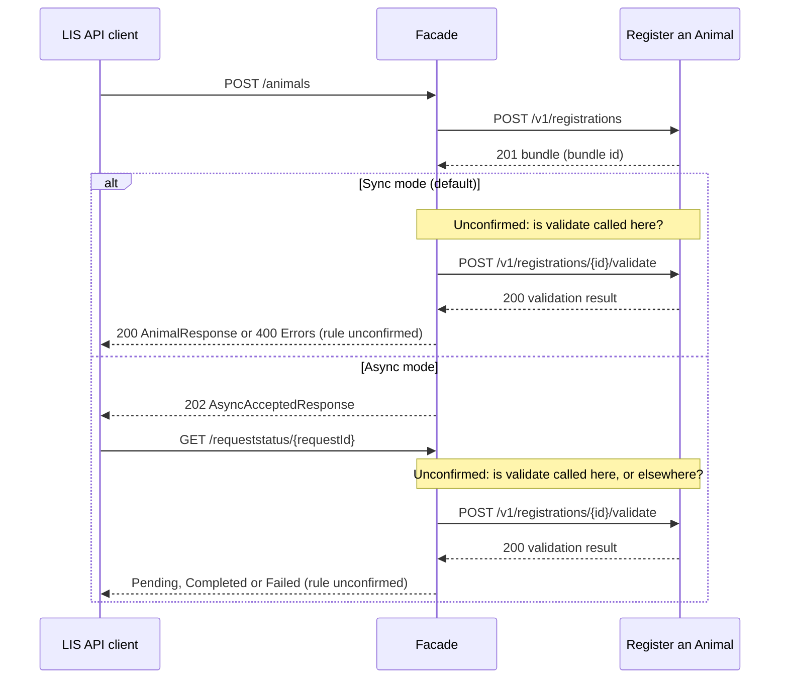

# POST /v1/registrations

This document is the mapping reference for implementing the facade translation layer and identifying any required contract changes. The tables show the corresponding fields, transformations, compatibility differences, and remaining mapping gaps for these endpoints.

**Scope:** This document maps LIS `POST /animals` to Register an Animal `POST /v1/registrations` only. Register an Animal `POST /v1/registrations/{id}/validate` and LIS `GET /requeststatus/{requestId}` are mentioned where they affect this mapping, but are not mapped here. They will be covered in separate mapping documents.

## Overview

### Object Mapping

| Register an Animal API object | LIS API object |
|--------------------------------|----------------|
| RegistrationBundleRequest containing AnimalRegistrationRequest | Animal |
| BundleResponse containing BundleAnimalResponse | AnimalResponse |
| BundleResponse | AsyncAcceptedResponse |
| ProblemDetails | Errors (array of ProblemDetails) |

### Endpoint Mapping

| Register an Animal API endpoint | LIS API endpoint |
|---------------------------------|------------------|
| POST /v1/registrations | POST /animals |

### Endpoint Descriptions

* **POST /v1/registrations** - Creates a bundle of cattle registrations for asynchronous validation and processing. The request contains a list of animal registrations and the response is a bundle.
* **POST /animals** - Creates one animal. LIS documents synchronous (`200`) and asynchronous (`202`) processing modes; the request mode is supplied in `LI-Request-Mode` and defaults to `sync`.

## Request Mapping

The direction below is **LIS request -> Register an Animal request**. LIS requires one `animal` and one `registration` object. Register an Animal accepts a bundle with an `animals` array. Its schema does not declare any request properties as required, and it does not set a minimum array size.

### Animal details

| Register an Animal field | Data type | Nullable | Required | LIS field | Data type | Nullable | Required | Transformation | Missing fields | Datatype mismatch | Enum/value mismatch | Cardinality differences | Possible breaking change | Notes |
|--------------------------|-----------|----------|----------|-----------|------------|----------|----------|----------------|----------------|-------------------|---------------------|------------------------|--------------------------|-------|
| N/A | — | — | — | animal.genotype | string | Yes | No | No direct equivalent | Yes | No | No | No | No | No genotype field exists in AnimalRegistrationRequest. |
| animals[].earTag | string | No | No | animal.identifier | string | No | Yes | rename, structural nest change and cardinality change; place the single LIS animal in the bundle array | No | No | No | Yes | No | The single LIS animal becomes the only item in the Register an Animal `animals[]` array. |
| N/A | — | — | — | animal.name | string | No | No | No direct equivalent | Yes | No | No | No | No | No name field for the registered animal exists in AnimalRegistrationRequest; its sire.name refers to the sire. |
| N/A | — | — | — | animal.originalIdentifier | string | Yes | No | No direct equivalent | Yes | No | No | No | No | No original identifier field exists in AnimalRegistrationRequest. |
| N/A | — | — | — | animal.productionType | enum string (meat, dairy, beef) | No | No | No direct equivalent | Yes | No | N/A | No | No | No production type field exists in AnimalRegistrationRequest. |
| animals[].sex | string | Yes | No | animal.sex | enum string (female, male) | No | Yes | structural nest change, cardinality change and string/enum change | No | No | No | Yes | No | LIS accepts only "female" or "male" and requires a value. Register an Animal accepts any string, null or omission. A valid LIS value can be passed unchanged, so no value translation is needed. The facade should keep the LIS check on allowed values. The nullability differs, but a supplied non-null LIS value fits the Register an Animal field. |
| N/A | — | — | — | animal.species | enum string (bison, buffalo, cattle, deer, goats, sheep) | No | Yes | No direct equivalent | Yes | No | Yes | No | Yes | Register an Animal's request schema has no species field. The Register an Animal endpoint is specifically for cattle; agree whether the facade validates/rejects non-cattle LIS species or whether the Register an Animal contract must change. |

### Breed

| Register an Animal field | Data type | Nullable | Required | LIS field | Data type | Nullable | Required | Transformation | Missing fields | Datatype mismatch | Enum/value mismatch | Cardinality differences | Possible breaking change | Notes |
|--------------------------|-----------|----------|----------|-----------|------------|----------|----------|----------------|----------------|-------------------|---------------------|------------------------|--------------------------|-------|
| animals[].breed | string | Yes | No | breed.code | string | No | No | rename, structural nest change and cardinality change | No | No | No | Yes | Yes | Register an Animal states that the breed field is the code or name of the animal, not solely the code. This should be taken into consideration before mapping.   |

### Birth

| Register an Animal field | Data type | Nullable | Required | LIS field | Data type | Nullable | Required | Transformation | Missing fields | Datatype mismatch | Enum/value mismatch | Cardinality differences | Possible breaking change | Notes |
|--------------------------|-----------|----------|----------|-----------|------------|----------|----------|----------------|----------------|-------------------|---------------------|------------------------|--------------------------|-------|
| N/A | — | — | — | birth.assistedBirthFlag | boolean | No | Yes if birth is present | No direct equivalent | Yes | No | No | No | Yes | No birth flag exists in Register an Animal |
| animals[].dateOfBirth | date string | Yes | No | birth.date | date string | No | No | rename, structural nest change and cardinality change | No | No | No | Yes | No | The nullability differs, but a supplied non-null LIS value fits the Register an Animal field. |
| N/A | — | — | — | birth.embryoTransferFlag | boolean | No | Yes if birth is present | No direct equivalent | Yes | No | No | No | Yes | No birth flag exists in Register an Animal |
| N/A | — | — | — | birth.mark | string | No | No | No direct equivalent | Yes | No | No | No | No | No birth mark exists in Register an Animal |
| N/A | — | — | — | birth.multipleBirthsFlag | boolean | No | Yes if birth is present | No direct equivalent | Yes | No | No | No | Yes | No birth flag exists in Register an Animal |
| N/A | — | — | — | birth.site.identifiers[].identifier | string | No | Yes | No direct equivalent | Yes | No | No | No | Yes | No birth site identifier exists in Register an Animal. Example data of "27/811/2976" comes in CPH format but equivalent field is not present in Register an Animal. The identifier is required for each item in the array, but the array itself may be empty. |
| N/A | — | — | — | birth.year | integer | Yes | No | No direct equivalent | Yes | No | No | No | No | No birth year exists in Register an Animal |

`birth` is optional. If included, LIS requires `site`, `assistedBirthFlag`, `multipleBirthsFlag` and `embryoTransferFlag`. These child requirements apply only when `birth` is supplied; Register an Animal has no corresponding fields for the flags or birth site.

### Death

| Register an Animal field | Data type | Nullable | Required | LIS field | Data type | Nullable | Required | Transformation | Missing fields | Datatype mismatch | Enum/value mismatch | Cardinality differences | Possible breaking change | Notes |
|--------------------------|-----------|----------|----------|-----------|------------|----------|----------|----------------|----------------|-------------------|---------------------|------------------------|--------------------------|-------|
| N/A | — | — | — | death.carcassCollectionSite.identifiers[].identifier | string | No | Yes | No direct equivalent | Yes | No | No | No | Yes | No direct equivalent or confirmed derivation is documented in Register an Animal. The identifier is required for each item in the array, but the array itself may be empty. |
| N/A | — | — | — | death.date | date string | No | No | No direct equivalent | Yes | No | No | No | No | No direct equivalent or confirmed derivation is documented in Register an Animal. |
| N/A | — | — | — | death.reason.id  | string (uuid) | No | No | No direct equivalent | Yes | No | No | No | No | No direct equivalent or confirmed derivation is documented in Register an Animal. |
| N/A | — | — | — | death.site.identifiers[].identifier | string | No | Yes | No direct equivalent | Yes | No | No | No | Yes | No direct equivalent or confirmed derivation is documented in Register an Animal. The identifier is required for each item in the array, but the array itself may be empty. |
| N/A | — | — | — | death.tseTestRequiredFlag | boolean | No | No | No direct equivalent | Yes | No | No | No | No | No direct equivalent or confirmed derivation is documented in Register an Animal. |
| N/A | — | — | — | death.createdDateTime | date-time string | No | No | No direct equivalent | Yes | No | No | No | No | No direct equivalent or confirmed derivation is documented in Register an Animal. |
| N/A | — | — | — | death.updatedDateTime | date-time string | No | No | No direct equivalent | Yes | No | No | No | No | No direct equivalent or confirmed derivation is documented in Register an Animal. |

`death` is optional and may be `null`. Its details apply only when a death object is supplied. Register an Animal has no corresponding death fields.

### Parent details

| Register an Animal field | Data type | Nullable | Required | LIS field | Data type | Nullable | Required | Transformation | Missing fields | Datatype mismatch | Enum/value mismatch | Cardinality differences | Possible breaking change | Notes |
|--------------------------|-----------|----------|----------|-----------|------------|----------|----------|----------------|----------------|-------------------|---------------------|------------------------|--------------------------|-------|
| animals[].dam.surrogateDamEarTag | string | Yes | No | importParents.birthDam.identifier/registration.birthDam.identifier | string | No | Yes if parent object is present | rename, structural nest change and cardinality change | No | No | No | Yes | Yes | The LIS birthDam description identifies the animal giving birth; confirm this is the source's surrogate dam. Duplicate source of surrogate dam data (importParents.birthDam & registration.birthDam); agree precedence if both LIS locations are supplied and differ. The nullability differs, but a supplied non-null LIS value fits the Register an Animal field. |
| animals[].dam.geneticDamEarTag | string | Yes | No | importParents.geneticDam.identifier/registration.geneticDam.identifier | string | No | Yes if parent object is present | rename, structural nest change and cardinality change | No | No | No | Yes | Yes | Duplicate source of genetic dam data (importParents.geneticDam & registration.geneticDam); agree precedence if both LIS locations are supplied and differ. The nullability differs, but a supplied non-null LIS value fits the Register an Animal field. |
| animals[].sire.earTag | string | Yes | No | importParents.sire.identifier/registration.sire.identifier | string | No | Yes if parent object is present | rename, structural nest change and cardinality change | No | No | No | Yes | Yes | Duplicate source of sire data (importParents.sire.identifier & registration.sire.identifier); agree precedence if both LIS locations are supplied and differ. The nullability differs, but a supplied non-null LIS value fits the Register an Animal field. |
| animals[].dam.type | string | Yes | No | N/A | — | — | — | No confirmed value mapping | Yes | N/A | No | No | No | Leave unmapped. LIS exposes separate importParents.geneticDam and importParents.birthDam objects. damType could possibly be derived from these, but no derivation rule is confirmed. LIS also exposes registration.geneticDam and registration.birthDam; all four parent objects are ParentAnimal objects, but no derivation rule from them to damType is confirmed. |
| animals[].sire.name | string | Yes | No | N/A | — | — | — | N/A | Yes | No | No | No | No | No writable sire name field is available in the LIS POST request. |

### Registration

| Register an Animal field | Data type | Nullable | Required | LIS field | Data type | Nullable | Required | Transformation | Missing fields | Datatype mismatch | Enum/value mismatch | Cardinality differences | Possible breaking change | Notes |
|--------------------------|-----------|----------|----------|-----------|------------|----------|----------|----------------|----------------|-------------------|---------------------|------------------------|--------------------------|-------|
| N/A | — | — | — | registration.category | enum string (birthRegistration, registration) | No | Yes | No direct equivalent | Yes | No | N/A | No | Yes | No category field exists in AnimalRegistrationRequest. |
| N/A | — | — | — | registration.date | date string | No | Yes | No direct equivalent | Yes | No | No | No | Yes | dateOfBirth is not the registration date. The Register an Animal request has no registration-date field. |
| N/A | — | — | — | registration.identificationDate | date string | No | No | No direct equivalent | Yes | No | No | No | No | This is the date without a time component. No direct equivalent or confirmed derivation is documented in Register an Animal. |
| holding.cph | string | No | No | registration.site.identifiers[].identifier | string | No | Yes per item, if present | rename, structural nest change and cardinality change | No | No | No | Yes | Yes | Assumed correct field mapping as example identifier data "27/811/2976" matches CPH format. The identifiers array itself has no minimum size. No rule identifies which identifier is the CPH number; agree rule for determining. |

### Bundle details

| Register an Animal field | Data type | Nullable | Required | LIS field | Data type | Nullable | Required | Transformation | Missing fields | Datatype mismatch | Enum/value mismatch | Cardinality differences | Possible breaking change | Notes |
|--------------------------|-----------|----------|----------|-----------|------------|----------|----------|----------------|----------------|-------------------|---------------------|------------------------|--------------------------|-------|
| clientReference | string | No | No | N/A | — | — | — | N/A | Yes | No | No | No | No | The Register an Animal field is the client reference identifier for the registration bundle. LIS has no bundle-level client-reference field. No equatable mapping field.  |
| submittedBy | string | Yes | No | N/A | — | — | — | N/A | Yes | No | No | No | No | Register an Animal field submittedBy is the identifier of the user or system submitting the bundle. There is no equivalent field in LIS. |

**Request notes:**
* The LIS request header `LI-Request-Mode` (`sync` or `async`, default `sync`) decides whether the facade returns a LIS `200` or `202`. Register an Animal has no equivalent parameter. See the Response Mapping section for both paths.
* LIS accepts one animal per request, while Register an Animal accepts an animals array. The proposed mapping places the LIS animal into a single-item array.
* Only `animal` and `registration` are required at the top level of the LIS request. `breed`, `importParents`, `birth` and `death` are optional; `death` may also be `null`. The tables list relevant child fields rather than repeating each parent object as a separate mapping row. Required child fields apply only when their parent object is included.
* In Register an Animal, `holding` is optional and may be null. Its `cph` field is also optional, but must be a string when supplied. The proposed mapping uses `registration.site.identifiers[].identifier`, but a rule is needed to select the CPH identifier and handle missing or multiple matches.
* If `birth` is included, LIS requires `birth.site`, `birth.assistedBirthFlag`, `birth.multipleBirthsFlag` and `birth.embryoTransferFlag`. Register an Animal has no matching fields for the birth site or these flags.
* LIS requires `registration.site.identifiers`, but the array may be empty. Each item supplied must contain an `identifier`. The site activity type and identifier type are read-only, so they are not required client inputs. The facade therefore cannot rely on a client-supplied identifier type to select the CPH.
* LIS requires `animal.species`, but Register an Animal has no matching request field. The tables identify the other fields without confirmed mappings. How the facade handles supplied LIS values with no Register an Animal equivalent still needs agreement.
* In the LIS schema, `readOnly` fields are response-only: do not treat them as values supplied in the `POST /animals` request or map them into Register an Animal request.
* Field paths start at the request body. `[]` means an array item. Where a row lists two LIS paths separated by `/`, these are alternative locations for the value; the facade must not choose between conflicting values without an agreed rule.

**LIS read-only fields in the request schema (No mappings available):**
* `animal.state`; `breed.name`; `breed.crossBreed`.
* `currentSite` and `homeSite` (including their nested fields); `birthingHistory`; `createdDateTime`; `updatedDateTime`; `assurance` (including its nested fields).
* `importParents.{sire,geneticDam,birthDam}.{name,species,sex}` and `registration.{sire,geneticDam,birthDam}.{name,species,sex}`.
* `birth.site.type.{type,description}`, `birth.site.identifiers[].type`, and `birth.site.name`.
* `death.carcassCollectionSite.type.{type,description}`, `death.carcassCollectionSite.identifiers[].type`, `death.carcassCollectionSite.name`; `death.site.type.{type,description}`, `death.site.identifiers[].type`, `death.site.name`; `death.reason.name`; `death.receivedDate`.
* `registration.site.type.{type,description}`, `registration.site.identifiers[].type`, and `registration.site.name`.

**Register an Animal request fields without a confirmed LIS mapping:**
These fields have `N/A` in the LIS field column of the tables above, which retain the reasons.
* `clientReference`
* `submittedBy`
* `animals[].dam.type`
* `animals[].sire.name`

## Response Mapping

The direction below is **Register an Animal response -> LIS response**. Register an Animal returns one `BundleResponse` with an `animals` array; LIS returns one `AnimalResponse` in synchronous mode or an accepted-processing response in asynchronous mode.

**Response codes declared by these POST operations:**
* Register an Animal declares `201 Created`, `400 Bad Request` and `401 Unauthorized`.
* LIS declares `200 OK`, `202 Accepted`, `400 Bad Request`, `500 Server Error` and `503 Service Unavailable`.
* Both declare `400`. Register an Animal's success response is `201`, while LIS describes `200` for synchronous creation and `202` for asynchronous processing. The success mappings below are proposed comparisons, not an agreed status translation: creating a bundle does not establish that the animal has finished processing.

**Open question - create then validate:** Register an Animal has a second operation, `POST /v1/registrations/{id}/validate`, which checks a created bundle. Confirm whether the facade must call it before returning a LIS response (sync mode) or when the LIS API client checks the request status (async mode). Until this is agreed, the success mappings below are unconfirmed. See **Draft processing flow (unconfirmed)** below for the possible flow and the questions to confirm.

### 201 Created -> LIS 200 OK (mapping unconfirmed)

These tables compare Register an Animal's `BundleResponse` with the LIS `AnimalResponse`, not with the LIS `Animal` request schema.

#### Field mappings and LIS response gaps

| Register an Animal field | Data type | Nullable | Required | LIS field | Data type | Nullable | Required | Transformation | Missing fields | Datatype mismatch | Enum/value mismatch | Cardinality differences | Possible breaking change | Notes |
|--------------------------|-----------|----------|----------|-----------|-----------|----------|----------|----------------|----------------|-------------------|---------------------|-------------------------|--------------------------|-------|
| animals[].earTag | string | No | No | identifier | string (read-only) | No | No | rename, structural nest change and cardinality change | No | No | No | Yes | Yes | Pick the entry for the submitted animal from the animals list. Agree what to do if the list is empty, missing or has more than one entry. A 201 only confirms the bundle was created, not that the animal passed validation. Confirm whether validate must be called before this identifier is returned. |
| N/A | — | — | — | links.self | string (uri) (read-only) | No | No | No direct equivalent | Yes | N/A | N/A | N/A | No | Register an Animal returns no matching link. A rule for constructing the LIS link would need agreement. This LIS response field is optional and read-only. If built from the identifier, it depends on the same create-then-validate question. The facade would build this as `/animals/` plus the returned identifier, and only once the animal is confirmed. Confirm that the link resolves through GET /animals/{identifier}. |

#### Register an Animal fields without a LIS 200 response equivalent

These fields have no direct equivalent in LIS AnimalResponse. The shorter tables retain the field paths and reasons or impacts rather than repeating columns with no applicable mapping.

##### Animal details

| Register an Animal field | Reason / impact |
|--------------------------|-----------------|
| animals[].id | No animal UUID field exists in LIS AnimalResponse. Its identifier represents the animal identifier, not a confirmed mapping to this UUID. |
| animals[].submissionId | No submission identifier field exists in LIS AnimalResponse. |
| animals[].status | No animal status field exists in LIS AnimalResponse. Agree how processing status affects whether a successful LIS response can be returned. |
| animals[].dateBirth | No birth date field exists in LIS AnimalResponse. |
| animals[].sex | No sex field exists in LIS AnimalResponse. |
| animals[].breed | No breed field exists in LIS AnimalResponse. The breed object in the LIS request is not part of this response schema. |

##### Parent details

| Register an Animal field | Reason / impact |
|--------------------------|-----------------|
| animals[].damType | No dam type field exists in LIS AnimalResponse. |
| animals[].damGeneticEarTag | No genetic dam identifier field exists in LIS AnimalResponse. |
| animals[].damSurrogateEarTag | No surrogate dam identifier field exists in LIS AnimalResponse. |
| animals[].sireEarTag | No sire identifier field exists in LIS AnimalResponse. |
| animals[].sireName | No sire name field exists in LIS AnimalResponse. |

##### Animal validation errors

| Register an Animal field | Reason / impact |
|--------------------------|-----------------|
| animals[].errors[].id | No validation-error identifier field exists in LIS AnimalResponse. |
| animals[].errors[].animalId | No validation-error animal UUID field exists in LIS AnimalResponse. |
| animals[].errors[].errorCode | No validation-error code field exists in LIS AnimalResponse. |
| animals[].errors[].errorText | No validation-error text field exists in LIS AnimalResponse. |
| animals[].errors[].createdAt | No validation-error date field exists in LIS AnimalResponse. |

The `errors` array is optional and may be empty, but is not nullable. These are errors within the `201` bundle response, not the operation's HTTP `400` response. How they affect the LIS response still needs agreement.

##### Bundle details

| Register an Animal field | Reason / impact |
|--------------------------|-----------------|
| id | No bundle identifier field exists in LIS AnimalResponse. Do not use the bundle UUID as the animal identifier. |
| clientReference | No client reference field exists in LIS AnimalResponse. |
| countyParishHolding | No holding field exists in LIS AnimalResponse. |
| submittedBy | No submitted-by field exists in LIS AnimalResponse. |
| status | No bundle status field exists in LIS AnimalResponse. |
| createdAt | No bundle creation date field exists in LIS AnimalResponse. |

**Response notes:**
* Register an Animal describes asynchronous bundle processing. A `201` response confirms bundle creation, not necessarily completed animal registration. Establishing how the facade fulfils LIS synchronous processing needs consideration. The facade could match the returned animals[].earTag to the animal.identifier it sent to choose the entry. Confirm this.
* The `animals` array is optional, non-nullable and has no minimum or maximum size. LIS AnimalResponse describes one animal, so selecting a result requires an agreed rule.
* Register an Animal's bundle, animal and validation-error response properties are all optional. LIS AnimalResponse.identifier and links.self are also optional and non-nullable. A field being read-only does not make it required; read-only fields are valid response mappings. If animals[].errors[] contains entries, the bundle was created but the animal has problems. Agree whether the facade returns a LIS 400 in this case.
* Requiredness and nullability are separate: an optional non-nullable field may be omitted, but cannot be null when supplied.
* Register an Animal fields without a LIS equivalent are listed separately because supplied information cannot be carried in that LIS response. This is a possible loss of information, not a claim that LIS requires those fields. Optional LIS fields with no Register an Animal equivalent do not, by themselves, prevent a schema-valid response.
* The bundle `id` is not part of the LIS 200 `AnimalResponse`, so it is not returned in sync mode. In async mode it is a candidate for the LIS 202 `id` (see below), but this is unconfirmed. If the facade needs the bundle `id` to call validate or track progress later, it must keep it. Agree where the facade keeps it.
* This table maps the animal result returned immediately in sync mode. It can also be used for the animal result returned later through async request-status checking.
* Field paths start at the response body; `[]` means an array item. Parent objects and arrays are described in the notes rather than repeated as separate mapping rows.

### 201 Created -> LIS 202 Accepted (mapping unconfirmed)

LIS returns AsyncAcceptedResponse to acknowledge an async request. The mappings below are proposals: confirm whether the bundle ID can be used as the LIS request ID and how the bundle’s status relates to the progress of the LIS request.

| Register an Animal field | Data type | Nullable | Required | LIS field | Data type | Nullable | Required | Transformation | Missing fields | Datatype mismatch | Enum/value mismatch | Cardinality differences | Possible breaking change | Notes |
|--------------------------|-----------|----------|----------|-----------|-----------|----------|----------|----------------|----------------|-------------------|---------------------|-------------------------|--------------------------|-------|
| id | string (uuid) | No | No | id | string (uuid) | No | No | Potential identifier mapping | No | No | No | No | Yes | Confirm whether a bundle UUID represents the LIS async request identifier. LIS also specifies a lowercase UUID pattern; any format conversion needs agreement. |
| status | string | No | No | requestStatus | enum string (Pending, Completed, Failed) | No | No | rename and string/enum change | No | No | Yes | No | Yes | Register an Animal does not specify allowed status values. Confirm how they translate to the LIS enum before returning a value. |
| createdAt | date-time string | No | No | requestDate | date-time string | No | No | Potential rename | No | No | No | No | Yes | The date formats match, but confirm whether bundle creation time represents the LIS request date. |
| N/A | — | — | — | requestStatusUrl | Not defined | Not defined | Yes | No direct equivalent | Yes | N/A | N/A | N/A | Yes | LIS lists this field as required but does not define its type or format. Register an Animal returns no status URL. The contract and the rule for supplying this field need agreement. |

The other Register an Animal fields are listed in the section below. In LIS AsyncAcceptedResponse, the declared `id`, `requestStatus` and `requestDate` properties are optional and non-nullable. The required `requestStatusUrl` property must be present, but its allowed values are not defined.

#### Register an Animal fields without a LIS 202 response equivalent

These fields have no direct equivalent in LIS `AsyncAcceptedResponse`. The LIS 202 response acknowledges the request and provides tracking information; it does not contain the animal result or validation-error details. The proposed mappings for `id`, `status` and `createdAt` remain in the table above.

##### Animal details

| Register an Animal field | Reason / impact |
|--------------------------|-----------------|
| animals[].id | No animal UUID field exists in LIS AsyncAcceptedResponse. Its id identifies the processing request, not an individual animal. |
| animals[].submissionId | No separate submission identifier field exists in LIS AsyncAcceptedResponse. |
| animals[].status | No per-animal status field exists in LIS AsyncAcceptedResponse. How animal statuses affect the overall requestStatus needs agreement. |
| animals[].earTag | No animal identifier field exists in LIS AsyncAcceptedResponse. The animal identifier belongs in the eventual AnimalResponse, if provided. |
| animals[].dateBirth | No birth date field exists in LIS AsyncAcceptedResponse. |
| animals[].sex | No sex field exists in LIS AsyncAcceptedResponse. |
| animals[].breed | No breed field exists in LIS AsyncAcceptedResponse. |

##### Parent details

| Register an Animal field | Reason / impact |
|--------------------------|-----------------|
| animals[].damType | No dam type field exists in LIS AsyncAcceptedResponse. |
| animals[].damGeneticEarTag | No genetic dam identifier field exists in LIS AsyncAcceptedResponse. |
| animals[].damSurrogateEarTag | No surrogate dam identifier field exists in LIS AsyncAcceptedResponse. |
| animals[].sireEarTag | No sire identifier field exists in LIS AsyncAcceptedResponse. |
| animals[].sireName | No sire name field exists in LIS AsyncAcceptedResponse. |

##### Animal validation errors

| Register an Animal field | Reason / impact |
|--------------------------|-----------------|
| animals[].errors[].id | No validation-error identifier field exists in LIS AsyncAcceptedResponse. |
| animals[].errors[].animalId | No validation-error animal UUID field exists in LIS AsyncAcceptedResponse. |
| animals[].errors[].errorCode | No validation-error code field exists in LIS AsyncAcceptedResponse. |
| animals[].errors[].errorText | No validation-error text field exists in LIS AsyncAcceptedResponse. |
| animals[].errors[].createdAt | No validation-error date field exists in LIS AsyncAcceptedResponse. |

The `errors` array is optional, may be empty and is non-nullable. These errors are within the Register an Animal `201` response, not its HTTP `400` response. Agree how the facade handles any reported errors and whether returning LIS `202 Accepted` is appropriate.

##### Bundle details

| Register an Animal field | Reason / impact |
|--------------------------|-----------------|
| clientReference | No client reference field exists in LIS AsyncAcceptedResponse. |
| countyParishHolding | No holding field exists in LIS AsyncAcceptedResponse. |
| submittedBy | No submitted-by field exists in LIS AsyncAcceptedResponse. |

**Response notes:**
* A LIS 202 Accepted acknowledges an async request; it does not confirm that animal registration has completed. Register an Animal's 201 confirms bundle creation. Agree when the facade can translate this into a LIS 202.
* The proposed id, status and createdAt mappings need confirmation. A bundle ID is not automatically a LIS request ID, a bundle status is not automatically a LIS processing status, and bundle creation time may differ from when LIS received the request.
* LIS id, requestStatus and requestDate are optional and non-nullable: they may be omitted, but cannot be null when supplied. requestStatusUrl is listed as required but has no property definition, so its intended definition and how to populate it need confirmation.
* If the bundle response contains animal validation errors, do not assume processing can continue successfully. Agree whether the facade returns an immediate LIS error or accepts the request and reports failure later.
* LIS provides GET /requeststatus/{requestId} so the LIS API client can check progress after receiving 202 Accepted. It is mentioned here because the ID returned in the 202 response needs to support this later status check. Agree which ID the LIS API client should use and how the facade determines whether processing is Pending, Completed or Failed. Whether and when the facade calls Register an Animal’s separate validate operation remains unresolved; a status check should not be assumed to trigger validation.
* It is not clear what makes a request `Pending`, `Completed` or `Failed`. Register an Animal bundle `status` has no listed values, and a successful validate call does not by itself prove the animal is registered. Treat any status translation as unresolved until agreed.
* The initial 202 response contains no animal result. If a later request-status response includes an AnimalResponse, the identifier and link mappings in the LIS 200 section can be reused.

### 400 Bad Request -> LIS 400 Bad Request

Register an Animal returns one ProblemDetails object using `application/problem+json`; LIS expects an Errors array using `application/json`. 

| Register an Animal field | Data type | Nullable | Required | LIS field | Data type | Nullable | Required | Transformation | Missing fields | Datatype mismatch | Enum/value mismatch | Cardinality differences | Possible breaking change | Notes |
|--------------------------|-----------|----------|----------|-----------|-----------|----------|----------|----------------|----------------|-------------------|---------------------|-------------------------|--------------------------|-------|
| type | string | Yes | No | [].type | string (uri) | No | Yes per error item | structural nest change and URI validation | No | No | Yes | Yes | Yes | LIS requires a non-null URI with at most 1,024 characters. Register an Animal allows omission, null and strings without these constraints. Agree how to handle missing or incompatible values. |
| title | string | Yes | No | [].title | string | No | Yes per error item | structural nest change and length validation | No | No | Yes | Yes | Yes | LIS requires a non-null title with at most 1,024 characters. Register an Animal allows omission or null and sets no maximum length. |
| status | integer or integer-formatted string (int32) | Yes | No | [].status | integer (int32, 100–599) | No | Yes per error item | structural nest change; convert a string to an integer when valid | No | Yes | Yes | Yes | Yes | Register an Animal permits omission, null or a numeric string. LIS requires an integer between 100 and 599. Agree handling for missing, null or out-of-range values and ensure the value matches the facade HTTP status. |
| detail | string | Yes | No | [].detail | string | No | Yes per error item | structural nest change and length validation | No | No | Yes | Yes | Yes | LIS requires non-null detail with at most 4,096 characters. Register an Animal allows omission or null and sets no maximum length. |
| N/A | — | — | — | [].errors | ProblemDetails object | No | No | No direct equivalent | Yes | N/A | N/A | N/A | No | No matching nested errors field exists in Register an Animal ProblemDetails. LIS allows this optional object to contain another ProblemDetails object, with the same four required fields when included. |

#### Register an Animal error fields without a LIS equivalent

| Register an Animal field | Reason / impact |
|--------------------------|-----------------|
| instance | No instance field exists in LIS ProblemDetails. Its value cannot be carried in the declared LIS error fields. |

**Error response notes:**
* `[]` at the start of a LIS error path refers to an item in the root Errors array; there is no outer `errors` wrapper. The array requires 1–1,000 non-null ProblemDetails items.
* Placing one Register an Animal problem in a single-item LIS array addresses the structural difference, but does not supply missing required values or resolve nullability, format and length differences. Those rules still need agreement.
* LIS ProblemDetails.errors is an optional nested object, not the root array. If included, its required fields and any further nested errors objects follow the same schema.

### 401 Unauthorized -> LIS 500 Server Error (mapping unconfirmed)

Register an Animal declares `401` with ProblemDetails. LIS POST /animals declares neither `401` nor `403`. Register an Animal may return 401 if it rejects the facade’s service API key. This does not mean the LIS API client's credentials are invalid. For this case, the proposed mapping is LIS 500, using the LIS Errors response format, because the failure is on the service side. Agree the LIS status and error handling before applying the error-body mapping.

| Register an Animal field | Data type | Nullable | Required | LIS field | Data type | Nullable | Required | Transformation | Missing fields | Datatype mismatch | Enum/value mismatch | Cardinality differences | Possible breaking change | Notes |
|--------------------------|-----------|----------|----------|-----------|-----------|----------|----------|----------------|----------------|-------------------|---------------------|-------------------------|--------------------------|-------|
| type | string | Yes | No | [].type | string (uri) | No | Yes per error item | structural nest change and URI validation; agree a service-error type | No | No | Yes | Yes | Yes | LIS requires a non-null URI with at most 1,024 characters. Agree a type describing the facade's service failure rather than a LIS API client authentication failure. Missing or incompatible Register an Animal values need an agreed handling rule. |
| title | string | Yes | No | [].title | string | No | Yes per error item | structural nest change and length validation; agree a service-error title | No | No | Yes | Yes | Yes | LIS requires a non-null title with at most 1,024 characters. Use wording appropriate to a service-side failure, not a request for the LIS API client to change credentials. Register an Animal allows omission or null and sets no maximum length. |
| status | integer or integer-formatted string (int32) | Yes | No | [].status | integer (int32, 100–599) | No | Yes per error item | structural nest change and status replacement | No | Yes | Yes | Yes | Yes | If this mapping is agreed, set the LIS body status to integer 500 to match the facade HTTP response; do not copy the Register an Animal 401 value. |
| detail | string | Yes | No | [].detail | string | No | Yes per error item | structural nest change and length validation; agree safe service-error detail | No | No | Yes | Yes | Yes | LIS requires non-null detail with at most 4,096 characters. Agree safe wording that does not expose service credentials or sensitive authentication details. Register an Animal allows omission or null and sets no maximum length. |
| N/A | — | — | — | [].errors | ProblemDetails object | No | No | No direct equivalent | Yes | N/A | N/A | N/A | No | No matching nested errors field exists in Register an Animal ProblemDetails. This LIS object is optional; if included, its required fields must be supplied. |

The same root-array structure, required-field constraints and unmapped `instance` field described in the 400 section apply here. This is a proposed translation of a service authentication failure, not a direct copy of the Register an Animal error.

### 401 Unauthorized -> LIS 503 Service Unavailable (mapping unconfirmed)

Same error-body mapping and constraints as the LIS 500 mapping above, except the LIS HTTP response and body status would both be `503`. This is an alternative requiring separate agreement, not an automatic replacement for `500`. Use it only if the failure is classified as temporary service unavailability; rejection of the facade's service API key alone does not establish that retrying will help. Until agreed otherwise, `500` remains the proposed mapping.

### LIS 500 Server Error and 503 Service Unavailable

Both LIS responses use the Errors array described above. Register an Animal does not declare either response for POST /v1/registrations. Agree how the facade handles service failures, timeouts and unexpected responses; these are not confirmed one-to-one status mappings.

### Response headers

| Register an Animal response header | LIS response header | Data type | Declared on LIS responses | Notes |
|-----------------------------------|---------------------|-----------|---------------------------|-------|
| No corresponding header declared | LI-Request-Id | string (uuid) | 200, 202, 400, 500, 503 | LIS describes a request identifier. No Register an Animal response header mapping is documented; agree how the facade supplies it. |
| No corresponding header declared | LI-Correlation-Id | string (uuid) | 200, 202, 400, 500, 503 | LIS says a correlation identifier is generated if not provided. Agree how the facade preserves or generates this value; it is not a bundle or animal identifier. |
| No corresponding header declared | Retry-After | integer | 202 | LIS describes a delay in seconds/minutes without fixing a single unit. Confirm the unit and how the facade determines the delay. |

The LIS response headers are documented without a required declaration. They are separate from the response body fields and do not change their requiredness.

**Authentication and headers:**
* LIS applies both `Ocp-Apim-Subscription-Key` and bearer-token authentication globally. Register an Animal requires the `x-api-key` service-to-service header. The facade must authenticate LIS consumers and authenticate separately to Register an Animal; the specs do not define credential forwarding or translation.
* LIS accepts `LI-Request-Mode` (`sync` or `async`, default `sync`) and `LI-Correlation-Id`. Register an Animal documents neither parameter. The response header differences are listed above; facade handling still needs agreement.

## Draft processing flow (unconfirmed)

This is a draft for discussion, not an agreed design. It shows one possible way the facade could use Register an Animal's create operation (`POST /v1/registrations`) and validate operation (`POST /v1/registrations/{id}/validate`) to provide the LIS sync and async modes. Steps marked **unconfirmed** depend on the questions below. The same draft appears in the validate mapping document.

**Questions to confirm with the Register an Animal owners and the team:**

| # | Question | Why it matters |
|---|----------|----------------|
| 1 | Does Register an Animal validate the bundle by itself, or only when validate is called? | It decides whether the facade needs to call validate at all. |
| 2 | Is the validate `{id}` the same as the bundle `id`? The validate response uses `submissionId`. | The facade needs the right ID to call validate. |
| 3 | Does `isValid: true` mean the animal is registered, or only that its data is valid? | It decides when the facade can return `200` or `Completed`. |
| 4 | Is calling validate safe to repeat? | Repeated status checks could call it more than once. |
| 5 | In sync mode, does the facade call validate before returning `200`, and what happens if it is slow? | It decides the sync response and any time limit. |
| 6 | In async mode, is validate called when the LIS API client checks status, or in the background? | It decides how `Pending`, `Completed` and `Failed` are worked out. |
| 7 | How does a validation failure (`isValid: false`, returned as HTTP `200`) become a LIS `400` (sync) or `Failed` (async)? How are the required LIS error fields `type`, `title`, `status` and `detail` filled from `code` and `description`? | Register an Animal reports validation failures inside a success response. |
| 8 | Where does the facade store the link between the LIS request ID and the bundle ID? | Async tracking needs it, and neither API describes it. |

## Assumptions

These are the working assumptions the mappings rely on. Items marked **(unconfirmed)** are proposals that need agreement before implementation.

| Area | Assumption |
|------|------------|
| Scope | This document covers LIS `POST /animals` and Register an Animal `POST /v1/registrations` only. Register an Animal's validate operation and LIS `GET /requeststatus/{requestId}` are mentioned where they affect the mapping but are not mapped here. |
| Direction | Requests are translated from LIS to Register an Animal. Responses are translated from Register an Animal to LIS. |
| One animal per bundle | The facade sends each LIS `animal` as a single-item `animals[]` array in one Register an Animal bundle. |
| `earTag` | Request: LIS `animal.identifier` → Register an Animal `animals[].earTag`. The facade also uses the returned Register an Animal `animals[].earTag` to pick the matching animal in the Register an Animal response. |
| `holding.cph` | Request: LIS `registration.site.identifiers[].identifier` → Register an Animal `holding.cph`, because the LIS example identifier (`27/811/2976`) is in CPH format. How to pick the CPH entry is unconfirmed. |
| `dateOfBirth` | Request: LIS `birth.date` → Register an Animal `animals[].dateOfBirth`. |
| `breed` | Request: LIS `breed.code` → Register an Animal `animals[].breed`. Register an Animal accepts a code or a name for this field, so this needs checking before it is used. |
| Parent identifiers | Request: the LIS birth dam, genetic dam and sire identifiers → Register an Animal `animals[].dam.surrogateDamEarTag`, `animals[].dam.geneticDamEarTag` and `animals[].sire.earTag`. LIS has these under both `importParents` and `registration`, and which one takes precedence is unconfirmed. |
| `sex` | A LIS `animal.sex` value of `female` or `male` can be passed unchanged to Register an Animal `animals[].sex`, because Register an Animal accepts any string. |
| `dam.type` and `sire.name` | Register an Animal `animals[].dam.type` and `animals[].sire.name` remain unmapped. LIS has no writable field or confirmed derivation for them. |
| `clientReference` and `submittedBy` | Register an Animal `clientReference` and `submittedBy` remain unmapped. LIS has no matching request fields. |
| Read-only LIS fields | Read-only LIS fields are not request inputs and are not sent to Register an Animal. |
| Unmapped LIS fields | LIS request fields with no Register an Animal equivalent (such as `animal.genotype`, `birth` and `death`) remain unmapped, because no derivation is confirmed. |
| `201` response | A Register an Animal `201` confirms the bundle was created. It does not confirm that the animal passed validation or that registration is complete. The mapping to LIS `200` or `202` is unconfirmed. |
| `identifier` | Register an Animal `animals[].earTag` maps to LIS `identifier`. Register an Animal `animals[].id` and the bundle `id` are not used as the LIS `identifier`. |
| `links.self` | **(unconfirmed)** Proposed: the facade builds LIS `links.self` as `/animals/` plus the returned `identifier`, only once the animal is confirmed. The base path, what "confirmed" means, and whether the link resolves through LIS `GET /animals/{identifier}` need agreement. Returning the link does not call that endpoint. |
| Async fields | **(unconfirmed)** Register an Animal bundle `id`, `status` and `createdAt` are candidates for LIS `id`, `requestStatus` and `requestDate`. A Register an Animal bundle and a LIS processing request are not assumed to be the same thing. |
| `401` | **(unconfirmed)** A Register an Animal `401` may mean the facade's `x-api-key` was rejected, not that the LIS API client's credentials are wrong. Proposed mapping: LIS `500`, with `503` as an alternative only if the failure is agreed to be temporary. |

## Breaking-change summary

Compatibility is considered in both directions: LIS to Register an Animal for requests, and Register an Animal to LIS for responses.

These are potential breaks if the facade does not handle the differences below. The direction matters: a non-null LIS value can populate a nullable Register an Animal field, but a null or missing Register an Animal value cannot populate a required non-null LIS field. Renames and nesting changes need a transformation but are not breaking changes on their own.

In the mapping tables, a row with **Missing fields: Yes** and **Possible breaking change: No** means the information is lost because the other API has nowhere to hold it, but the facade can still produce a valid message, so this is not a breaking change.

| Category | Potential breaking change |
|----------|---------------------------|
| Required fields | LIS `animal.species`, `registration.date` and `registration.category` are required, but the Register an Animal request has no matching fields. If LIS `birth` is supplied, LIS also requires `birth.site` and three birth flags, which Register an Animal has no fields for. Missing values must not be invented. |
| Nullability | LIS to Register an Animal: a non-null LIS value fits the nullable Register an Animal fields. Register an Animal to LIS: Register an Animal error fields `type`, `title`, `detail` and `status` can be null or missing, but the LIS error fields require non-null values. |
| Datatype | Register an Animal error `status` can be an integer, an integer-formatted string or null, while LIS error `status` must be an integer from 100 to 599. Register an Animal bundle `status` is a plain string, while LIS `requestStatus` is `Pending`, `Completed` or `Failed`. |
| Allowed values | LIS `animal.species`, `registration.category` and `animal.productionType` have fixed values, but Register an Animal has no matching request fields, so these values cannot be passed on or checked. Register an Animal bundle `status` has no listed values, so it cannot be safely translated to the LIS `requestStatus` values. |
| Missing data | LIS request fields with no Register an Animal equivalent: `animal.genotype`, `animal.name`, `animal.originalIdentifier`, `animal.productionType`, `animal.species`, `registration.category`, `registration.date`, `registration.identificationDate`, `birth.site`, `birth.mark`, `birth.year`, the three `birth` flags and all `death` fields. Register an Animal request fields with no LIS source: `clientReference`, `submittedBy`, `animals[].dam.type` and `animals[].sire.name`. Register an Animal response fields with no LIS response field are listed in the Response Mapping section. |
| Cardinality | LIS `animal` is one animal, but Register an Animal `animals[]` is an array. In the response, Register an Animal `animals[]` can be empty, missing or hold several entries, but LIS returns one `identifier`. |
| Site identifiers | LIS `registration.site.identifiers[]` can hold several identifiers, while Register an Animal has one optional `holding.cph`. The LIS identifier `type` (what kind of identifier it is) is read-only, so the LIS API client does not supply it. The facade needs another rule to pick the CPH. |
| Parent and breed meaning | LIS has `sire`, `geneticDam` and `birthDam` objects under both `importParents` and `registration`. Register an Animal has `dam.geneticDamEarTag`, `dam.surrogateDamEarTag` and `sire.earTag`. The LIS birth dam may not mean the same as the Register an Animal surrogate dam. LIS `breed` is an object, while Register an Animal `breed` is one string that can hold a code or a name. |
| Processing behaviour | LIS `POST /animals` has sync (`200`) and async (`202`) modes. Register an Animal `POST /v1/registrations` returns `201` when a bundle is created, which does not confirm the animal is registered. Register an Animal also has a separate validate operation. Whether the facade must call it, and when, is undecided. |
| Async tracking | LIS `AsyncAcceptedResponse` requires `requestStatusUrl`, which Register an Animal does not provide and LIS does not define. It is unconfirmed whether a Register an Animal bundle `id` can be the LIS request `id`, and how progress is worked out for LIS `GET /requeststatus/{requestId}`. |
| Response structure | Register an Animal returns bundle, animal and validation-error details. LIS `AnimalResponse` returns only `identifier` and `links.self`, so the other Register an Animal fields cannot be carried in the LIS response. Register an Animal has no link field for LIS `links.self`. |
| Error contract | Register an Animal returns one `ProblemDetails` object (`application/problem+json`), while LIS returns an array of `ProblemDetails` items (`application/json`). Register an Animal `instance` has no LIS field, and LIS limits the length of `type`, `title` and `detail`. |
| Status codes | Register an Animal `POST /v1/registrations` declares `201`, `400` and `401`; LIS `POST /animals` declares `200`, `202`, `400`, `500` and `503`. The `201` to `200`/`202` mapping is unconfirmed. A Register an Animal `401` is proposed to map to LIS `500` (or `503`), because it may mean the facade's own key was rejected. |
| Authentication and headers | LIS API clients use `Ocp-Apim-Subscription-Key` and a bearer token, while Register an Animal uses `x-api-key`. LIS headers `LI-Request-Mode`, `LI-Request-Id`, `LI-Correlation-Id` and `Retry-After` have no Register an Animal equivalent. The specs do not say how the facade handles them. |

## Recommendations and remaining gaps

| Area | Recommendation or remaining gap |
|------|---------------------------------|
| Request scope | Confirm the facade creates one Register an Animal bundle for each LIS `animal` request. Agree whether an empty, missing or multi-entry `animals[]` in the Register an Animal response is valid. |
| Unsupported values | Agree whether the facade rejects or ignores LIS request values that Register an Animal cannot accept, such as `animal.genotype`, `birth` and `death`. Do not discard or invent values without a decision. |
| Required fields | Agree how LIS `animal.species`, `registration.date`, `registration.category` and any supplied `birth` fields are handled, as Register an Animal has no matching request fields. Consider whether the facade rejects non-cattle `animal.species` values. Do not discard or fabricate values without a contract decision. |
| Holding identifier | LIS `registration.site.identifiers[]` can contain several identifiers, while Register an Animal has one optional `holding.cph`. The LIS identifier `type` describes what kind of identifier it is, but is read-only, so the LIS API client does not supply it. Agree how the facade identifies which value is the CPH and what it does if none or several match. |
| Bundle metadata | Register an Animal has optional request fields `clientReference` and `submittedBy`. LIS has no matching request fields. Agree whether the facade leaves them empty or fills them, and if so, what values or source it uses. |
| Breed and parent mappings | Register an Animal `animals[].breed` accepts a breed code or name. Confirm that LIS `breed.code` is accepted. Agree whether LIS `importParents` or `registration` parent values take precedence, and whether the LIS birth dam can be used as the Register an Animal surrogate dam. |
| Create then validate | Decide whether the facade must call Register an Animal `POST /v1/registrations/{id}/validate`, and whether this happens before a LIS sync response or when the LIS API client checks LIS async status. Confirm what a passing validation proves. Until agreed, the success mappings are unconfirmed. See the draft processing flow and its eight questions. |
| Choosing the animal | Pick the Register an Animal `animals[]` entry whose `earTag` matches the LIS `animal.identifier` that was sent. Agree what happens if no entry or several entries match. |
| Bundle ID | The Register an Animal bundle `id` is not part of the LIS `AnimalResponse`. The facade may need it to validate the bundle or track progress later. Agree where the facade keeps it. |
| Async tracking | Agree which ID the LIS API client uses with LIS `GET /requeststatus/{requestId}` and how the facade decides whether a request is `Pending`, `Completed` or `Failed`. The `identifier` and `links.self` mapping can be reused for a completed result. Agree the LIS `Retry-After` unit. |
| `requestStatusUrl` | LIS `AsyncAcceptedResponse` lists `requestStatusUrl` as required but does not define its type or format. Register an Animal has no matching field. Agree what the facade should return; it may be a link to LIS `GET /requeststatus/{requestId}`, but the contract does not confirm this. |
| `links.self` | Agree how the facade builds LIS `links.self` (`/animals/` plus the returned `identifier`), including the base path and when the animal counts as confirmed. Confirm it resolves through LIS `GET /animals/{identifier}`. |
| Errors inside a `201` | Agree what the facade does when the Register an Animal `201` response contains `animals[].errors[]`: return a LIS `400`, or report the failure later. Do not treat a `201` with errors as a success. |
| Error responses | Convert one Register an Animal `ProblemDetails` object into a single-item LIS error array. Agree how to fill missing, null or over-long `type`, `title`, `detail` and `status` values, and set the LIS body `status` to match the HTTP status. Register an Animal `instance` has no LIS field. |
| `401` mapping | Do not return a Register an Animal `401` unchanged. It may mean the facade's `x-api-key` was rejected, not that the LIS API client's credentials are wrong. Agree whether it maps to LIS `500` (proposed) or `503`; do not automatically convert it to `401` or `403`. |
| `500` and `503` | Agree how timeouts, failures and unexpected Register an Animal responses become LIS `500` or `503`, using the LIS error format. |
| Authentication and headers | Handle LIS API client authentication and Register an Animal `x-api-key` authentication separately. Agree how the facade handles LIS `LI-Request-Mode`, `LI-Request-Id` and `LI-Correlation-Id`. |
