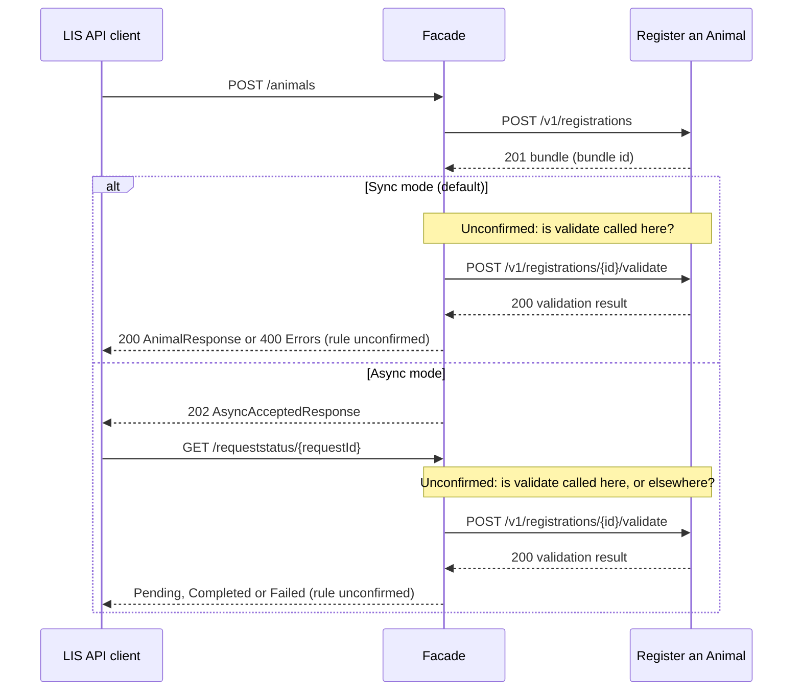

# POST /v1/registrations/{id}/validate

This document is the mapping reference for implementing the facade translation layer and identifying any required contract changes. The tables show the corresponding fields, transformations, compatibility differences, and remaining mapping gaps for these endpoints.

**Scope:** This document maps Register an Animal `POST /v1/registrations/{id}/validate` to LIS `GET /requeststatus/{requestId}` only. Register an Animal `POST /v1/registrations` and LIS `POST /animals` are mentioned where they affect this mapping, but are not mapped here. They are covered in the `POST /v1/registrations` mapping document.

## Overview

### Object Mapping

| Register an Animal API object | LIS API object |
|--------------------------------|----------------|
| SubmissionValidationResult | RequestStatus |
| SubmissionAnimalValidationResult | AnimalResponse (the `result` of RequestStatus) |
| ValidationErrorItem | No LIS equivalent |
| ProblemDetails | Errors (array of ProblemDetails) |

### Endpoint Mapping

| Register an Animal API endpoint | LIS API endpoint |
|---------------------------------|------------------|
| POST /v1/registrations/{id}/validate | GET /requeststatus/{requestId} |

### Endpoint Descriptions

* **POST /v1/registrations/{id}/validate** - Validate a cattle registration bundle - Validates the cattle registration bundle identified by its unique ID. It has no request body and returns a validation result.
* **GET /requeststatus/{requestId}** - Get async http request status - Returns the status of an asynchronous LIS request (`Pending`, `Completed` or `Failed`) and, optionally, a result.

## Request Mapping

The direction below is **LIS request -> Register an Animal request**. Neither operation has a request body. Each has one required path parameter that is a UUID (a unique identifier).

| Register an Animal field | Data type | Nullable | Required | LIS field | Data type | Nullable | Required | Transformation | Missing fields | Datatype mismatch | Enum/value mismatch | Cardinality differences | Possible breaking change | Notes |
|--------------------------|-----------|----------|----------|-----------|-----------|----------|----------|----------------|----------------|-------------------|---------------------|-------------------------|--------------------------|-------|
| id (path parameter) | string (uuid) | No | Yes | requestId (path parameter) | string (uuid, lowercase pattern) | No | Yes | rename and ID lookup (mapping unconfirmed) | No | No | No | No | Yes | The facade needs the Register an Animal bundle ID to call validate, but the LIS `requestId` is not assumed to be that ID. Agree where the facade keeps the link between the two (question 8 in the draft processing flow). LIS requires a lowercase UUID, so a Register an Animal `id` sent back to the LIS API client would need that format. |

**Request notes:**
* This mapping is unconfirmed: it assumes the facade can find the Register an Animal bundle `id` from the LIS `requestId`. However, how this can be done is not clearly defined. Further investigation is required.
* It is not clear that Register an Animal's validate `{id}` is the bundle `id` returned by `POST /v1/registrations`. The validate response calls it `submissionId`. Bundle and submission may be the same thing - either "submission" is another word for "bundle", or there is a separate submission ID that differs from bundle id.
* LIS `GET /requeststatus/{requestId}` declares no query parameters or request headers. Register an Animal validate declares only the `id` path parameter.
* LIS `GET` requests are normally safe to repeat, but Register an Animal validate is a `POST`. It is not clear whether calling it again is safe, so a LIS status check must not be assumed to call it.

**LIS read-only fields in the request schema:** none.

## Response Mapping

The direction below is **Register an Animal response -> LIS response**.

**Response codes declared by these operations:**
* Register an Animal declares `200 OK`, `401 Unauthorized` and `404 Not Found`.
* LIS declares `200 OK`, `404 Not Found`, `500 Server Error` and `503 Service Unavailable`.
* Both declare `200` and `404`. LIS declares no `401`, so a Register an Animal `401` has no matching LIS status (see below). Register an Animal declares no `500` or `503`.
* A Register an Animal `200` means validate ran and returned a result. It does not prove the animal is registered, and a `200` can still carry `isValid: false`.

**Open question - create then validate:** Register an Animal's validate operation checks a bundle that `POST /v1/registrations` has already created. Confirm whether the facade calls validate when the LIS API client checks the request status, or at another time. Until this is agreed, the success mapping below is unconfirmed. See **Draft processing flow (unconfirmed)** below for the possible flow and the questions to confirm.

### 200 OK -> LIS 200 OK (mapping unconfirmed)

These tables compare Register an Animal's `SubmissionValidationResult` with the LIS `RequestStatus`. None of the fields in either schema is required. LIS `status` is read-only, so it is only sent in responses.

#### Status

| Register an Animal field | Data type | Nullable | Required | LIS field | Data type | Nullable | Required | Transformation | Missing fields | Datatype mismatch | Enum/value mismatch | Cardinality differences | Possible breaking change | Notes |
|--------------------------|-----------|----------|----------|-----------|-----------|----------|----------|----------------|----------------|-------------------|---------------------|-------------------------|--------------------------|-------|
| isValid | boolean | No | No | status | enum string (Pending, Completed, Failed) (read-only) | No | No | rename, type conversion and string/enum change (mapping unconfirmed) | No | Yes | Yes | No | Yes | Proposed: `isValid: false` maps to `Failed` (see the validation failure section below). `isValid: true` is not assumed to mean `Completed`, because it may only mean the data is valid. Agree what `true` maps to. |
| status | string | No | No | status | enum string (Pending, Completed, Failed) (read-only) | No | No | string/enum change (mapping unconfirmed) | No | No | Yes | No | Yes | Register an Animal does not list allowed `status` values, so it cannot be safely translated to the LIS enum. Agree the values and how they relate to `isValid` before this is used. |

#### Animal result

LIS `result` is optional and can hold either an `AnimalResponse` or a `MovementResponse1`. The proposed mapping uses `AnimalResponse`, because the Register an Animal result is about animals. The Register an Animal spec has no movement concept: it contains no movement operations, schemas or fields.

| Register an Animal field | Data type | Nullable | Required | LIS field | Data type | Nullable | Required | Transformation | Missing fields | Datatype mismatch | Enum/value mismatch | Cardinality differences | Possible breaking change | Notes |
|--------------------------|-----------|----------|----------|-----------|-----------|----------|----------|----------------|----------------|-------------------|---------------------|-------------------------|--------------------------|-------|
| animalResults[].earTag | string | No | No | result.identifier | string (read-only) | No | No | rename, structural nest change and cardinality change (mapping unconfirmed) | No | No | No | Yes | Yes | Proposed: use this only for a single-animal submission, and only once the animal is confirmed as registered. Agree what to do if `animalResults[]` is empty, missing or has more than one entry. A passing validation is not assumed to prove registration. |
| N/A | — | — | — | result.links.self (AnimalResponse) | string (uri) (read-only) | No | No | No direct equivalent | Yes | N/A | N/A | N/A | No | Register an Animal returns no link. If built, the facade would use `/animals/` plus the returned identifier, as in the `POST /v1/registrations` mapping document. Confirm that the link resolves through LIS `GET /animals/{identifier}`. |
| N/A | — | — | — | result.movementNumber (MovementResponse1) | number (read-only) | No | No | No direct equivalent | Yes | N/A | N/A | N/A | No | Register an Animal has no movement concept, so it has no movement number to supply. This LIS `result` option is not used by this mapping. |
| N/A | — | — | — | result.links.self (MovementResponse1) | string (uri) (read-only) | No | No | No direct equivalent | Yes | N/A | N/A | N/A | No | As above. This is the movement link, not an animal link. |

#### Register an Animal fields without a LIS 200 equivalent

These fields have no direct equivalent in LIS `RequestStatus`. The shorter table keeps the field paths and reasons or impacts rather than repeating columns with no applicable mapping.

| Register an Animal field | Reason / impact |
|--------------------------|-----------------|
| submissionId | No submission identifier exists in LIS `RequestStatus`. It is not clear whether it equals the bundle `id` or the LIS `requestId`. |
| errorCount | No error count exists in LIS `RequestStatus`. It is an integer or integer-formatted string. |
| animalResults[].animalId | No animal UUID exists in LIS `AnimalResponse`, which only has `identifier` and `links.self`. |
| animalResults[].isValid | No per-animal validity field exists in LIS `RequestStatus`. How it affects the overall `status` needs agreement. |
| animalResults[].errors[].code | No validation-error code exists in LIS `RequestStatus`. The code is lost unless an error response is used instead. |
| animalResults[].errors[].description | No validation-error text exists in LIS `RequestStatus`. The text is lost unless an error response is used instead. |

**Response notes:**
* Field paths start at the response body; `[]` means an array item. Parent objects and arrays are described in the notes rather than repeated as separate mapping rows.
* LIS `status` and `result` are optional, but the facade should supply `status`, because without it the LIS API client cannot tell what is happening. This is a facade decision, not a schema rule.
* It is not clear what makes a request `Pending`, `Completed` or `Failed`. Register an Animal `status` has no listed values, and a successful validate call does not by itself prove the animal is registered. `Pending` has no clear source in the validate result at all. Treat any status translation as unresolved until agreed.
* Whether the facade calls validate when the LIS API client checks the status is unresolved, so a LIS status check must not be assumed to trigger validation.
* Register an Animal `animalResults[]` is an array, while LIS `result` holds one animal. This is why the `earTag` mapping is limited to a single-animal submission.
* Register an Animal has two different `isValid` fields. The top-level `isValid` says whether the whole submission is valid, and it is the one proposed for LIS `status`. `animalResults[].isValid` says whether one animal is valid, and has no LIS field. It is not clear whether the top-level value is always `false` when any animal's value is `false`, or how `errorCount` relates to the animal errors. Confirm this before the facade relies on either field.

### 200 OK with `isValid: false` -> LIS 200 OK with `status: Failed` (mapping unconfirmed)

Register an Animal reports validation failures inside a successful `200` response. LIS `GET /requeststatus/{requestId}` declares no `400`, so the proposed mapping is a LIS `200` with `status` set to `Failed` and no `result`.

* The LIS `RequestStatus` has nowhere to hold `animalResults[].errors[].code`, `animalResults[].errors[].description` or `errorCount`. The LIS API client would see that the request failed, but not why. This is missing information, not an invalid message.
* The alternative is to return a LIS error response instead of a `200`. LIS declares only `404`, `500` and `503` errors for this operation, none of which describes a validation failure. Confirm which approach is wanted (question 7 in the draft processing flow).
* If a LIS `Failed` status is later extended to carry error details, the Register an Animal `code` and `description` fields are the likely source, but this is not defined in either spec.

### 404 Not Found -> LIS 404 Not Found

Register an Animal returns one `ProblemDetails` object using `application/problem+json`; LIS expects an `Errors` array using `application/json`. Register an Animal `404` presumably means the bundle for the `id` was not found (inferred from the operation summary; the spec only says "Not Found"). LIS `404` means the `requestId` was not found. It is not clear whether the facade can tell these apart, because it depends on the stored link between the LIS request ID and the bundle ID.

| Register an Animal field | Data type | Nullable | Required | LIS field | Data type | Nullable | Required | Transformation | Missing fields | Datatype mismatch | Enum/value mismatch | Cardinality differences | Possible breaking change | Notes |
|--------------------------|-----------|----------|----------|-----------|-----------|----------|----------|----------------|----------------|-------------------|---------------------|-------------------------|--------------------------|-------|
| type | string | Yes | No | [].type | string (uri) | No | Yes per error item | structural nest change and URI validation | No | No | Yes | Yes | Yes | LIS requires a non-null URI with at most 1,024 characters. Register an Animal allows omission, null and strings without these constraints. Agree how to handle missing or incompatible values. |
| title | string | Yes | No | [].title | string | No | Yes per error item | structural nest change and length validation | No | No | Yes | Yes | Yes | LIS requires a non-null title with at most 1,024 characters. Register an Animal allows omission or null and sets no maximum length. |
| status | integer or integer-formatted string (int32) | Yes | No | [].status | integer (int32, 100–599) | No | Yes per error item | structural nest change; convert a string to an integer when valid | No | Yes | Yes | Yes | Yes | Register an Animal permits omission, null or a numeric string. LIS requires an integer between 100 and 599. Set the LIS body status to `404` to match the facade HTTP response. |
| detail | string | Yes | No | [].detail | string | No | Yes per error item | structural nest change and length validation | No | No | Yes | Yes | Yes | LIS requires non-null detail with at most 4,096 characters. Register an Animal allows omission or null and sets no maximum length. |
| N/A | — | — | — | [].errors | ProblemDetails object | No | No | No direct equivalent | Yes | N/A | N/A | N/A | No | No matching nested errors field exists in Register an Animal ProblemDetails. This LIS object is optional; if included, its four required fields must be supplied. |

#### Register an Animal error fields without a LIS equivalent

| Register an Animal field | Reason / impact |
|--------------------------|-----------------|
| instance | No instance field exists in LIS ProblemDetails. Its value cannot be carried in the declared LIS error fields. |

**Error response notes:**
* `[]` at the start of a LIS error path refers to an item in the root Errors array; there is no outer `errors` wrapper. The array requires 1–1,000 non-null ProblemDetails items.
* Placing one Register an Animal problem in a single-item LIS array addresses the structural difference, but does not supply missing required values or resolve nullability, format and length differences. Those rules still need agreement.
* LIS ProblemDetails.errors is an optional nested object, not the root array. If included, its required fields and any further nested errors objects follow the same schema.

### 401 Unauthorized -> LIS 500 Server Error (mapping unconfirmed)

Register an Animal declares `401` with ProblemDetails. LIS `GET /requeststatus/{requestId}` declares neither `401` nor `403`. Register an Animal may return `401` if it rejects the facade's service API key. This does not mean the LIS API client's credentials are invalid. For this case, the proposed mapping is LIS `500`, using the LIS Errors response format, because the failure is on the service side. Agree the LIS status and error handling before applying the error-body mapping.

| Register an Animal field | Data type | Nullable | Required | LIS field | Data type | Nullable | Required | Transformation | Missing fields | Datatype mismatch | Enum/value mismatch | Cardinality differences | Possible breaking change | Notes |
|--------------------------|-----------|----------|----------|-----------|-----------|----------|----------|----------------|----------------|-------------------|---------------------|-------------------------|--------------------------|-------|
| type | string | Yes | No | [].type | string (uri) | No | Yes per error item | structural nest change and URI validation; agree a service-error type | No | No | Yes | Yes | Yes | LIS requires a non-null URI with at most 1,024 characters. Agree a type describing the facade's service failure rather than a LIS API client authentication failure. |
| title | string | Yes | No | [].title | string | No | Yes per error item | structural nest change and length validation; agree a service-error title | No | No | Yes | Yes | Yes | LIS requires a non-null title with at most 1,024 characters. Use wording appropriate to a service-side failure. Register an Animal allows omission or null and sets no maximum length. |
| status | integer or integer-formatted string (int32) | Yes | No | [].status | integer (int32, 100–599) | No | Yes per error item | structural nest change and status replacement | No | Yes | Yes | Yes | Yes | If this mapping is agreed, set the LIS body status to integer `500` to match the facade HTTP response; do not copy the Register an Animal `401` value. |
| detail | string | Yes | No | [].detail | string | No | Yes per error item | structural nest change and length validation; agree safe service-error detail | No | No | Yes | Yes | Yes | LIS requires non-null detail with at most 4,096 characters. Agree safe wording that does not expose service credentials or sensitive authentication details. |
| N/A | — | — | — | [].errors | ProblemDetails object | No | No | No direct equivalent | Yes | N/A | N/A | N/A | No | No matching nested errors field exists in Register an Animal ProblemDetails. This LIS object is optional; if included, its required fields must be supplied. |

The same root-array structure, required-field constraints and unmapped `instance` field described in the 404 section apply here. This is a proposed translation of a service authentication failure, not a direct copy of the Register an Animal error.

### 401 Unauthorized -> LIS 503 Service Unavailable (mapping unconfirmed)

Same error-body mapping and constraints as the LIS 500 mapping above, except the LIS HTTP response and body status would both be `503`. This is an alternative requiring separate agreement, not an automatic replacement for `500`. Use it only if the failure is classified as temporary service unavailability; rejection of the facade's service API key alone does not establish that retrying will help. Until agreed otherwise, `500` remains the proposed mapping.

### LIS 500 Server Error and 503 Service Unavailable

Both LIS responses use the Errors array described above. Register an Animal does not declare either response for validate. Agree how the facade handles service failures, timeouts and unexpected responses; these are not confirmed one-to-one status mappings.

### Response headers

| Register an Animal response header | LIS response header | Data type | Declared on LIS responses | Notes |
|-----------------------------------|---------------------|-----------|---------------------------|-------|
| No corresponding header declared | LI-Request-Id | string (uuid) | 200, 404, 500, 503 | LIS describes a request identifier. Register an Animal declares no response headers for validate. Agree how the facade supplies it. |
| No corresponding header declared | LI-Correlation-Id | string (uuid) | 200, 404, 500, 503 | LIS says a correlation identifier is generated if not provided. This operation declares no request header for it, so agree how the facade preserves or generates it. It is not a bundle or animal identifier. |
| No corresponding header declared | Retry-After | integer (seconds) | 503 | HTTP defines an integer Retry-After value as a delay in seconds. The LIS description mentions seconds/minutes, but the facade must emit seconds; agree how it determines the delay. |

The LIS response headers are documented without a required declaration. They are separate from the response body fields and do not change their requiredness.

**Authentication and headers:**
* LIS applies both `Ocp-Apim-Subscription-Key` and bearer-token authentication globally. Register an Animal requires the `x-api-key` service-to-service header. The facade must authenticate LIS API clients and authenticate separately to Register an Animal; the specs do not define credential forwarding or translation.
* LIS `GET /requeststatus/{requestId}` does not document `LI-Request-Mode`. Register an Animal validate documents no request headers other than `x-api-key`. Facade handling of the LIS response headers is listed above and still needs agreement.

## Draft processing flow (unconfirmed)

This document maps validate (`POST /v1/registrations/{id}/validate`) to the LIS request-status and error responses. It is the second call in the draft processing flow below, which is unconfirmed and also appears in the `POST /v1/registrations` mapping document.

This is a draft for discussion, not an agreed design. It shows one possible way the facade could use Register an Animal's create operation (`POST /v1/registrations`) and validate operation (`POST /v1/registrations/{id}/validate`) to provide the LIS sync and async modes. Steps marked **unconfirmed** depend on the questions below. The same draft appears in the `POST /v1/registrations` mapping document.

**Questions to confirm with the Register an Animal owners and the team:**

| # | Question | Why it matters |
|---|----------|----------------|
| 1 | Does Register an Animal validate the bundle by itself, or only when validate is called? | It decides whether the facade needs to call validate at all. |
| 2 | Is the validate `{id}` the same as the bundle `id`? The validate response uses `submissionId`. | The facade needs the right ID to call validate. |
| 3 | Does `isValid: true` mean the animal is registered, or only that its data is valid? | It decides when the facade can return `200` or `Completed`. |
| 4 | Is calling validate safe to repeat? | Repeated status checks could call it more than once. |
| 5 | In sync mode, does the facade call validate before returning `200`, and what happens if it is slow? | It decides the sync response and any time limit. |
| 6 | In async mode, is validate called when the LIS API client checks status, or in the background? | It decides how `Pending`, `Completed` and `Failed` are worked out. |
| 7 | How does a validation failure (`isValid: false`, returned as HTTP `200`) become a LIS `400` (sync) or `Failed` (async)? How are the required LIS error fields `type`, `title`, `status` and `detail` filled from `code` and `description`? | Register an Animal reports validation failures inside a success response. |
| 8 | Where does the facade store the link between the LIS request ID and the bundle ID? | Async tracking needs it, and neither API describes it. |

## Assumptions

These are the working assumptions the mappings rely on. Items marked **(unconfirmed)** are proposals that need agreement before implementation.

| Area | Assumption |
|------|------------|
| Scope | This document covers Register an Animal `POST /v1/registrations/{id}/validate` and LIS `GET /requeststatus/{requestId}` only. Register an Animal `POST /v1/registrations` and LIS `POST /animals` are mentioned where they affect the mapping but are not mapped here. |
| Direction | Requests are translated from LIS to Register an Animal. Responses are translated from Register an Animal to LIS. |
| Request ID | **(unconfirmed)** Request: LIS `requestId` -> Register an Animal `id`. The facade is assumed to hold the link between the LIS request ID and the Register an Animal bundle ID. Neither API describes this link. |
| Validate is called | The mapping describes what Register an Animal validate returns if it is called. It is not assumed that the facade calls it, when it is called, or that it is safe to repeat. See the draft processing flow. |
| `isValid: false` | **(unconfirmed)** Response: Register an Animal `isValid: false` -> LIS `status: Failed`, returned in a LIS `200`. Error details from `animalResults[].errors[]` are not carried, because LIS `RequestStatus` has nowhere to hold them. |
| `isValid: true` | A Register an Animal `isValid: true` is not assumed to mean the animal is registered, so it is not assumed to map to LIS `Completed`. |
| `status` | **(unconfirmed)** Response: Register an Animal `status` and `isValid` are candidates for LIS `status`. Register an Animal `status` has no listed values, so no value translation is assumed. |
| `result.identifier` | **(unconfirmed)** Response: Register an Animal `animalResults[].earTag` -> LIS `result.identifier`, only for a single-animal submission and only once the animal is confirmed as registered. LIS `result` is assumed to be an `AnimalResponse`, not a `MovementResponse1`, because Register an Animal has no movement concept. |
| `result.links.self` | **(unconfirmed)** The facade builds LIS `result.links.self` as `/animals/` plus the returned `identifier`, as in the `POST /v1/registrations` mapping document. Returning the link does not call LIS `GET /animals/{identifier}`. |
| `404` | Response: Register an Animal `404` -> LIS `404`, with the single `ProblemDetails` object placed in a one-item `Errors` array. It is not confirmed that the facade can tell a missing bundle from an unknown LIS `requestId`. |
| `401` | **(unconfirmed)** A Register an Animal `401` may mean the facade's `x-api-key` was rejected, not that the LIS API client's credentials are wrong. Proposed mapping: LIS `500`, with `503` as an alternative only if the failure is agreed to be temporary. |
| Unmapped Register an Animal fields | Register an Animal `submissionId`, `errorCount`, `animalResults[].animalId`, `animalResults[].isValid`, `animalResults[].errors[].code` and `animalResults[].errors[].description` remain unmapped, because LIS `RequestStatus` has no matching fields. |

## Breaking-change summary

Compatibility is considered in both directions: LIS to Register an Animal for requests, and Register an Animal to LIS for responses.

These are potential breaks if the facade does not handle the differences below. The direction matters: a non-null LIS value can populate a nullable Register an Animal field, but a null or missing Register an Animal value cannot populate a required non-null LIS field. Renames and nesting changes need a transformation but are not breaking changes on their own.

In the mapping tables, a row with **Missing fields: Yes** and **Possible breaking change: No** means the information is lost because the other API has nowhere to hold it, but the facade can still produce a valid message, so this is not a breaking change.

| Category | Potential breaking change |
|----------|---------------------------|
| Request ID | LIS `requestId` is not known to be the Register an Animal bundle `id`. Without a stored link, the facade cannot build the Register an Animal validate request. It is also not confirmed that the validate `{id}` is the bundle `id`. |
| Required fields | None of the fields in Register an Animal `SubmissionValidationResult` or LIS `RequestStatus` is required. In LIS errors, `type`, `title`, `status` and `detail` are required, so the facade must supply them when Register an Animal leaves them out. |
| Nullability | Register an Animal to LIS: Register an Animal error fields `type`, `title`, `detail` and `status` can be null or missing, but the LIS error fields require non-null values. The validate result fields are not nullable. |
| Datatype | Register an Animal `isValid` is a boolean and `status` is a plain string, while LIS `status` is `Pending`, `Completed` or `Failed`. Register an Animal error `status` can be an integer, an integer-formatted string or null, while LIS error `status` must be an integer from 100 to 599. |
| Allowed values | Register an Animal `status` has no listed values, so it cannot be safely translated to the LIS `status` values. Nothing in the validate result clearly maps to `Pending`. |
| Missing data | Register an Animal response fields with no LIS response field: `submissionId`, `errorCount`, `animalResults[].animalId`, `animalResults[].isValid`, `animalResults[].errors[].code`, `animalResults[].errors[].description` and the error `instance`. LIS fields with no Register an Animal source: `result.links.self` and the movement `result` fields. |
| Cardinality | Register an Animal `animalResults[]` can be empty, missing or hold several entries, but LIS `result` holds one animal. |
| Validation failures | Register an Animal returns validation failures inside a `200` response (`isValid: false`), while LIS declares no validation error for this operation. The proposed mapping to `Failed` loses the error codes and descriptions. |
| Processing behaviour | Register an Animal validate is a `POST` and LIS request status is a `GET`. It is not confirmed that validate is safe to repeat, that a status check should call it, or that `isValid: true` proves registration. |
| Status codes | Register an Animal validate declares `200`, `401` and `404`; LIS `GET /requeststatus/{requestId}` declares `200`, `404`, `500` and `503`. A Register an Animal `401` is proposed to map to LIS `500` (or `503`), because it may mean the facade's own key was rejected. LIS has no `400` or `401` for this operation. |
| Error contract | Register an Animal returns one `ProblemDetails` object (`application/problem+json`), while LIS returns an array of `ProblemDetails` items (`application/json`). Register an Animal `instance` has no LIS field, and LIS limits the length of `type`, `title` and `detail`. |
| Authentication and headers | LIS API clients use `Ocp-Apim-Subscription-Key` and a bearer token, while Register an Animal uses `x-api-key`. LIS headers `LI-Request-Id`, `LI-Correlation-Id` and `Retry-After` have no Register an Animal equivalent.  |

## Recommendations and remaining gaps

| Area | Recommendation or remaining gap |
|------|---------------------------------|
| Request ID link | Agree where the facade keeps the link between the LIS `requestId` and the Register an Animal bundle `id`, and confirm the validate `{id}` is the bundle `id`. Agree what happens when no link is found. |
| Create then validate | Decide whether the facade calls Register an Animal `POST /v1/registrations/{id}/validate` when the LIS API client checks status, or at another time, and whether it is safe to repeat. Confirm what a passing validation proves. Until agreed, the success mapping is unconfirmed. See the draft processing flow and its eight questions. |
| Status values | Agree how Register an Animal `isValid` and `status` become LIS `Pending`, `Completed` or `Failed`. Ask the Register an Animal owners for the list of `status` values. |
| Validation failures | Confirm that `isValid: false` returns LIS `200` with `Failed`, or whether a LIS error response is wanted. Agree whether the Register an Animal error `code` and `description` need to reach the LIS API client, which would need a LIS contract change. |
| Result identifier | Agree whether LIS `result.identifier` is filled from Register an Animal `animalResults[].earTag`, and what the facade does if `animalResults[]` is empty or has several entries. |
| `links.self` | Agree how the facade builds LIS `result.links.self` (`/animals/` plus the returned `identifier`), including the base path and when the animal counts as confirmed. Confirm it resolves through LIS `GET /animals/{identifier}`. |
| Error responses | Convert one Register an Animal `ProblemDetails` object into a single-item LIS error array. This is a choice: alternatives are replacing the body with a facade-written error, using the optional nested LIS `errors` field, or returning fixed LIS errors by status code. Agree how to fill missing, null or over-long `type`, `title`, `detail` and `status` values, and set the LIS body `status` to match the HTTP status. Register an Animal `instance` has no LIS field. |
| `404` meaning | Agree how the facade tells a missing bundle from an unknown LIS `requestId`, and what the LIS API client sees in each case. |
| `401` mapping | Do not return a Register an Animal `401` unchanged. It may mean the facade's `x-api-key` was rejected, not that the LIS API client's credentials are wrong. Agree whether it maps to LIS `500` (proposed) or `503`; do not automatically convert it to `401` or `403`. |
| `500` and `503` | Agree how timeouts, failures and unexpected Register an Animal responses become LIS `500` or `503`, using the LIS error format. Emit LIS `Retry-After` as an integer number of seconds, as HTTP defines, and agree how the facade determines the delay. |
| Authentication and headers | Handle LIS API client authentication and Register an Animal `x-api-key` authentication separately. Agree how the facade handles LIS `LI-Request-Id` and `LI-Correlation-Id`. |
